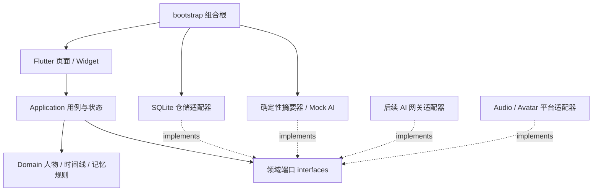
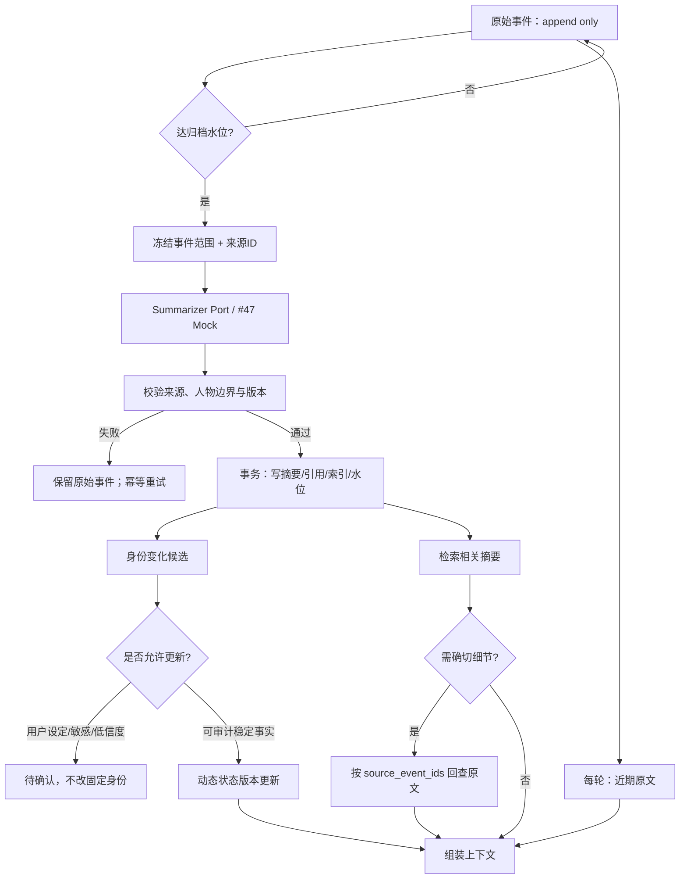

# 正式 Flutter 工程架构：人物中心与记忆优先

> 状态：Issue #34 的设计基线；涉及长期架构选择另见 [ADR-0004 提议](../decisions/0004-person-centered-memory-architecture.md)
> 日期：2026-11-18
> 依赖：ADR-0001 Flutter/Dart（已接受）、ADR-0002 首版 Android/iOS（已接受）
> 产品约束：[人物中心持续陪伴](person-centered-companion-principles-20261118.md)
> 任务主线：#34 架构 → #35 最小正式工程 → #36 原始数据层 → #47 离线记忆 → #38 后端方案 → #39 真实模型联调

## 1. 执行摘要

**设计主体是人物（Character / Persona），不是模型请求、对话会话或归档批次。** 一个用户可创建多个不同人物；每个人物严格对应一条逻辑上持续存在的时间线。内部实现可以分批存储、按窗口调用模型及创建归档，但用户只有「与这个人物继续说话」这一条连续对话，不需要管理多个会话。用户拥有原始互动、人物资料和派生记忆，支持全量可携带导出。

本文件提出：

1. 保留 `apps/mobile_poc/` 作为已验收的独立能力试验场；#35 推荐另建最小正式 Flutter 应用 `apps/mobile/`，不原地大规模改造 PoC。
2. 正式应用先使用清晰的业务功能边界、构造函数依赖注入和 Flutter 自带轻量状态原语，不为了未来的多平台/多服务提前引入大型框架。
3. 按用户 + 人物限定数据范围，SQLite 本地优先；不以模型供应商 session_id / HTTP request_id 作为业务时间线的主键。
4. 拆分原始时间线、记忆归档/摘要索引和人物身份版本；#47 使用可插拔的确定性 Mock 先通过离线行为测试，再由 #38/#39 对接真实服务、衡量模型质量与 Prompt Cache。
5. 为 AI、音频、Avatar 和未来云同步定义小而稳定的端口；不从未合并 PR 中引入未经审查的实现。

本设计是待后续实现逐步证实的架构方案，不代表正式工程已经存在。ADR-0004 当前仅为提议，下一项 #35 开始前需由项目发起人确认。

## 2. 输入、已知事实与外部设计复用

### 2.1 当前 main 的 PoC

- `apps/mobile_poc/lib/data.dart`：已有 SQLite `characters(id,name,description)`、`messages(id,character_id,author,text,status,reply_to)`、`preferences`。`messages_character` 索引按人物过滤，`savePair` 使用事务，打开数据库时将残留 `pending` 标为 `interrupted`。**这是 PoC schema v1，不是正式多租户数据/服务接口。**
- `apps/mobile_poc/lib/chat_controller.dart`：角色切换先取消在途生成，再取对应角色消息；重试复用既有用户消息，能为未来的生成状态机提供测试用例。当前只处理模拟回复，未构成完整真实记忆。
- `apps/mobile_poc/integration_test/acceptance_test.dart`：20 轮中文/emoji 输入、取消后的迟到回复、角色快速切换、100 行 SQLite 重开恢复等回归路径。
- `apps/mobile_poc/integration_test/storage_failure_test.dart`：故意造成 SQLite 写入失败，检查成对保存、草稿和重试不会遗留孤立消息。
- 当前 CI 仅验证快速 Flutter/Android 任务；#31 的 Android 模拟器集成 CI 暂缓，不把尚未成功的 PR #32 当作已经纳入 main。

### 2.2 尚未合并 PR 的复用决策

| 来源 | 参考内容 | #34 的处理 | 后续限制 |
|---|---|---|---|
| [#15](https://github.com/wangyz0518-bit/erciyuan_AI/pull/15) | Sketch/沉浸聊天与历史面板 | UI 思路仅参考 | 不把历史面板变成多会话列表 |
| [#16](https://github.com/wangyz0518-bit/erciyuan_AI/pull/16) | Flutter 页面拆分、角色切换/录音生命周期测试 | 提取可复用的测试边界与组件职责 | 不把旧分支整体引入正式工程 |
| [#17](https://github.com/wangyz0518-bit/erciyuan_AI/pull/17) | Avatar 包契约、Android Live2D 导入/校验 | 定义可替换 Avatar 适配端口 | iOS/许可证/真机另行验证，不能直接作为首版默认运行时 |
| [#20](https://github.com/wangyz0518-bit/erciyuan_AI/pull/20) | AI 分层图片到 Cubism 的制作链路 | 素材生产研究参考 | PR 内 ADR-0003 未被 main 接受 |
| [#21](https://github.com/wangyz0518-bit/erciyuan_AI/pull/21) | `request_id`、上下文过滤、取消/重试、SSE | 生成任务与模型端口语义参考 | 本机开发网关，不具生产多租户鉴权 |
| [#22](https://github.com/wangyz0518-bit/erciyuan_AI/pull/22) | 流式事件、连接/重试、迟到音频隔离 | 传输与生成状态分离的参考 | 不把 v2 技术会话当人物时间线；iOS PCM 未验证 |
| [#24](https://github.com/wangyz0518-bit/erciyuan_AI/pull/24) | 幂等任务状态、音色归属、绑定事务 | 资源归属和幂等设计参考 | 本机单用户配置，未做用户级授权 |

以上 #15～#24 全部归 `wangyz0518-bit` 所有，本轮**只阅读**，不修改、合并或关闭其 PR。#35～#47 选择性复用前仍需复核差异、许可证、安全、测试和当前 main 兼容性。

## 3. 工程结构选择

### 3.1 对比

| 路径 | 优点 | 风险与代价 | 建议 |
|---|---|---|---|
| 在 PoC `apps/mobile_poc/` 原地重构 | 一开始少一个工程目录 | 在正在使用的试验能力上引入迁移/测试回退风险；难区分验收证据 | 不推荐 |
| 从 PoC 复制所有代码到正式 App | 初始界面容易运行 | 把模拟 AI、旧会话术语和实验插件一起带入正式架构 | 不推荐 |
| **保留 PoC，另建最小 `apps/mobile/`** | 新数据边界和测试独立，逐条移植已验证行为；便于后续 iOS/CI | 需要维护两个工程入口，需避免长期重复维护 | **推荐，待 #35 启动时确认** |

### 3.2 建议目录（#35 才真正创建）

```text
apps/
  mobile_poc/                # 保留：现有 Flutter 设备/交互验证
  mobile/                    # 建议：正式 Flutter App（#35 新建）
    lib/
      app/                   # App root、导航、主题、启动组合根
      features/
        characters/          # domain + application + data + presentation
        timeline/            # RawEvent、唯一时间线、读写/分页
        memory/              # 归档、摘要器端口、索引、身份版本、上下文装配
        chat/                # 用户输入与生成状态、后续正式 Chat UI
        data_portability/    # 全量导出、将来导入与删除
      integrations/
        ai/                  # Mock / real provider adapter（#38/#39）
        audio/               # 录音与播放（#42）
        avatar/              # 静态/Live2D Renderer adapter（#44）
      bootstrap.dart         # 组合根，只在此装配依赖
    test/                    # 纯 Dart/Flutter 单元、Widget 测试
    integration_test/        # 独立数据库与设备能力验证
docs/
  design/                    # 架构草案、数据契约与参考
  decisions/                 # ADR：提议与已接受明确分离
plan/                        # 任务分解、执行路线与确认门槛
```

内部建议每个业务 feature 分 `domain/`（实体/规则/端口）、`application/`（用例/事务编排）、`data/`（SQLite/外部实现）、必要时 `presentation/`。**不预建没有调用方的空文件夹或接口**；#35 只创建当前会使用的最小入口和一个从 UI 到 Application 的测试路径。

不在本阶段建立多个 Dart package；只有出现多个实际消费者或独立版本需求时才评估拆包，以避免初期版本/导出配置复杂化。

## 4. 依赖规则与运行边界



- 依赖方向：`presentation → application → domain/ports`；`data/integrations → domain ports`。Application 可调用别的 feature 的公共端口，不直接引用其 Widget 或 SQLite 表。
- `memory` 通过 `TimelineReadPort` 获取原始事件，不直接持有聊天 UI 状态；`ContextAssembler` 只输出上下文片段/来源引用，不负责请求网络模型。
- `ChatUseCase` 负责发送、取消、重试、按人路由与最终持久化；`ModelClient` 只负责一次独立模型生成。模型 provider session 仅存在于 adapter 内。
- **构造函数注入**是初始 DI 策略；#35 不引入 Service Locator 或全局静态可变容器。启动组合根负责 owner scope、DB、Repository 与各用例生命周期。
- **状态管理**：#35 优先用 Flutter `ChangeNotifier` / `ValueNotifier` 搭配不可变数据快照与显式取消 Token，保持可测试；如 #37 的复杂状态要求扩展再评估 Riverpod 等第三方方案，避免提前锁定。
- **导航**：初期 Flutter `Navigator` 的显式路由足够；若日后深链接、多窗口恢复要求出现再评估路由依赖。用户导航只有人物主页、单条持续时间线和我的/数据管理，不提供新建会话页。

## 5. 人物与记忆的领域边界

详细实体与事务语义见[人物记忆数据契约](person-memory-data-contract-20261118.md)。

| 概念 | 唯一性/边界 | 不变量 |
|---|---|---|
| DataOwner | 本机 owner scope；账户系统留后续 | 每次读写检索都带 owner_id；数据导出可覆盖该 owner 全部人物 |
| Character | owner_id + character_id | 不同人物数据不共享 |
| CharacterTimeline | owner_id + character_id，唯一一条 | 前端不暴露内部归档为新聊天 |
| RawEvent | owner_id + character_id + event_id | 原文/来源可追溯，归档不删除 |
| ArchiveSegment | 关联同一时间线的一段原始事件 | 后台组织单元，无“新会话”语义 |
| MemorySummary / SourceRef | 摘要与原始 event 的多对多引用 | 禁止跨人物引用 |
| PersonaIdentityVersion | 固定设定 + 动态状态各自版本 | 动态摘要不能覆写用户明确的固定设定 |
| GenerationTask | owner_id、character_id、request_id | 重试/取消/迟到回复不能跨人物落库 |

本机离线安装没有账户体系时，以私有安装 ID 作为 owner scope，不能将其伪装为联网用户认证；引入真实后端时由 #38 明确 user_id 映射和服务器侧授权，不相信客户端任意传入的 owner_id。

## 6. 三层记忆执行通路



先由 #36 实现事务性原始记录；#47 实现无真实模型依赖的归档、摘要、来源引用、记忆候选和上下文装配；#38/#39 再对接真实模型。此顺序避免「为了模拟记忆必须先部署生产服务」的循环依赖。

### 6.1 生成任务与本地数据事务

1. 输入先形成对应人物的用户 RawEvent（按 request_id 幂等去重）。
2. 生成任务记录自己的状态：`pending → streaming → complete|failed|cancelled|interrupted`；不将未完成的 assistant 文本注入下一轮真实上下文。
3. 最终 assistant RawEvent 只在完成且可持久化时进入有效上下文；流式片段是进度快照，不等同事实层完整消息。
4. 取消、切人物、页面退出时，旧 request_id 的迟到数据只可在其原 owner/character/request scope 内处理；不能写到当前新人物。
5. SQLite 的部分写入必须失败回滚；后台归档水位只能在摘要、来源引用与索引提交成功后前进。

### 6.2 数据导出与所有权

导出按 owner 生成包含所有 Character、每人全量 RawEvent、归档片段、摘要/来源关系、身份版本和附件清单的版本化包；未实现的可选层明确为空数组与状态信息，不得静默省略已有历史。导出过程需取得一致读取快照，导出校验摘要与原始事件引用，不能只导出当前屏幕的消息。详细格式见数据契约；#36 先实现当前实际存在的层，#47 扩展到三层。

## 7. Prompt Cache 与检索边界

每轮上下文由稳定到动态：

```text
[固定系统约束 / prompt 模板版本]
[人物基础身份 + 已确认稳定状态 / persona_version]   <-- 稳定可缓存前缀
[当前目标与检索摘要，带来源 event_id]              <-- 动态
[该人物近期原始事件]                               <-- 动态
[按需回查的历史原始事件]                           <-- 动态
[当前用户输入]                                     <-- 动态
```

- `PersonaPrefixSerializer` 使用确定性字段顺序、固定换行/转义和版本号；不把当前时间、随机请求 ID、检索结果等放入稳定前缀。
- 前缀缓存的逻辑 key 包含 `owner_id + character_id + model + prompt_template_version + persona_version`，但绝不把它当作跨用户共享密钥或服务商真实 cache key。
- 人物身份频繁变化会降低缓存命中率：只在有版本化、可追溯的稳定状态更新时刷新前缀；短时情绪/本轮消息放在动态区域。
- #47 在离线测试中验证同一人物+相同版本生成字节完全一致的前缀，改变人物或身份版本会区分隔离域。
- **真实供应商缓存命中率、读写计费和召回质量由 #39 以实际模型和样本测量**；不能从 Mock 测试推断真实命中率，也不能承诺“无限 Token”。

## 8. 测试计划与阶段验收

| 阶段 / Issue | 优先测试 | 不得误报 |
|---|---|---|
| #34（本次） | 数据关系、状态流、依赖 DAG 的静态审查；文档链接与决策边界检查 | 设计文档不等于实现 |
| #35 | Flutter 最小 App 编译、状态/路由/DI 单元测试，Android Debug CI | iOS/真机未验证 |
| #36 | SQLite 迁移、重启恢复、唯一时间线、跨人物读写拒绝、写入失败回滚、全量导出 | 无摘要生成，不宣称已有完整记忆 |
| #47 | 归档幂等、来源引用完整性、故障水位、身份候选审核、离线 Mock 检索/回查、上下文/导出快照 | 离线摘要质量与实际 LLM 不等价 |
| #38 | 多租户鉴权模型、TLS/服务端密钥、请求范围与数据归属的接口/威胁审查 | 本机网关不是生产部署 |
| #39 | 真实模型流式/取消/重试、人物隔离、缓存命中率、Token、长历史召回与成本，提供样本和指标 | 不用单次样本承诺 SLA |
| #37 及后续 | 角色主页、输入/历史/导出 UI；多屏/键盘/无障碍 | 不把 #14 HTML 演示当正式 UI |

测试数据均用合成身份、中文/emoji 与长历史；不能上传私人聊天或用户录音。离线测试至少覆盖 2 个 owner × 每 owner 2 个人物、重复归档、错误人物来源 ID、取消后迟到事件、重启恢复和导出完整性。

## 9. 取舍与后续确认

- **选定的建议**：保留 PoC、另建正式 Flutter 工程；构造函数注入；Flutter 内置轻量状态；SQLite 本地优先；领域端口隔离 LLM/audio/avatar；Mock 摘要器先建立记忆内核。
- **未最终定案**：具体生产后端、LLM/ASR/TTS 供应商、账户/云同步、静态/Live2D 首版表现、数据库加密/跨设备恢复策略、精确归档阈值和向量检索引擎。对应后续 Issue 中调查。
- **待用户在 #35 启动前确认**：是否接受 [ADR-0004 提案](../decisions/0004-person-centered-memory-architecture.md) 中建议的正式工程分离与领域隔离。#34 的设计稿可完成并合并，但提议 ADR 不会因合并自动变成已接受。

## 参考

- [正式架构 ADR-0004 提议](../decisions/0004-person-centered-memory-architecture.md)
- [三层记忆及用户数据契约](person-memory-data-contract-20261118.md)
- [人物中心产品原则](person-centered-companion-principles-20261118.md)
- [Issue #34 执行清单](../../plan/issue-34-memory-architecture-20261118.md)
- [Issue #47 三层记忆实现](https://github.com/wangyz0518-bit/erciyuan_AI/issues/47)
- [当前 PoC 开发与验证指南](../guides/flutter-poc-guide-20261112.md)
