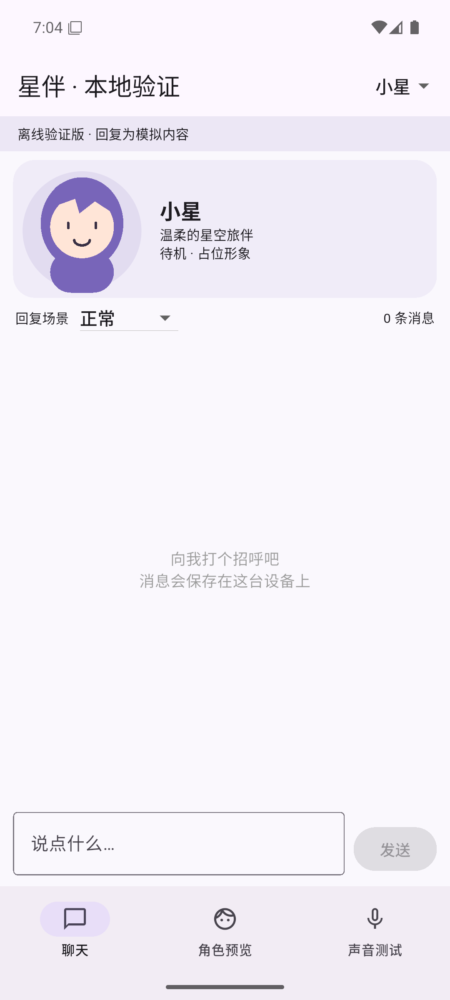
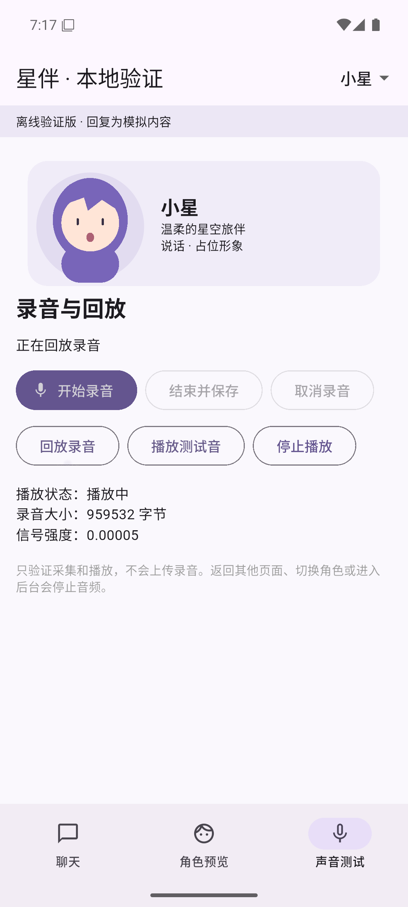

# 第一批 Android 模拟器验证记录

> 状态：评审中
> 日期：2026-11-12
> 负责人：待定
> 关联：A/B/C/D、ADR-0001、ADR-0002、任务 #10

## 范围

按已确认的第一批七项计划验证本地 Flutter 工程。使用两名固定角色“小星”“小月”、占位绘图和模拟回复。SQLite、Android 录音与播放插件是真实调用；未接外部模型、语音识别、语音合成、图片生成或 Live2D。Android/iOS 真机仍未验证，本报告不关闭 #10。

首轮七项均已执行。聊天操作、角色切换、占位人物展示和持续操作通过。中文输入、重启恢复和录音播放在首轮部分通过，后续结果见[三项复测](#三项复测)。

## 环境

- Windows 11，Flutter 3.50.0 / Dart 3.14.0。
- Android Emulator 37.2.13，Android 16 / API 36，x86_64，Pixel 6a 配置，4 GB 内存。
- CPU 使用 WHPX；自动图形模式因主机 NVIDIA 驱动低于模拟器 Vulkan 要求而采用软件渲染。
- Debug APK，主要开发工具、SDK、虚拟手机和缓存位于 D 盘；未重启 Windows。
- `sqflite 2.4.6`、`record 7.2.0`、`audioplayers 6.8.1`、`path_provider 2.1.6`，确切依赖见 `pubspec.lock`。
- 系统音频端点为 UU 远程虚拟扬声器和麦克风；远程音频转发与模拟器输入需要分别确认。

## 首轮七项结果

| 项目 | 已执行内容 | 结果 |
| --- | --- | --- |
| 1 中文输入与布局 | 中文、表情、多行长文本经 Flutter 测试输入；空白禁发；实际弹出/收起 Gboard，输入框可见、人物区缩小；安装简体拼音布局并点击字母键 | 部分通过；Gboard 提示等待语言包下载，`nihao` 未出现中文候选，真实拼音选词待复测 |
| 2 聊天操作 | UI 发送 20 轮；逐步显示；同步重复提交；失败重试；延迟 6 秒后取消并等候迟到结果 | 通过，本地模拟回复 |
| 3 角色切换 | 在待回复时连续切换 10 次，检查归属及旧结果；重试沿用原用户消息 | 通过 |
| 4 保存与恢复 | 两个角色各 50 条，三份 SQLite 快照逐条比较；强制停止应用、重新启动、关闭并正常启动模拟器 | 部分通过；正常重启无丢失/重复，角色选择保留；一次 `-no-snapshot-load` 冷启动后安装列表找不到本应用，原因待查 |
| 5 人物展示 | 四种表情、三种活动、动画开关、缺失回退、页面切换；占位头像与聊天同屏 | 通过占位组件范围；真实素材路线未验证 |
| 6 录音与播放 | 系统权限拒绝后实际发出文字并收到模拟回复；录音保存/回放操作；取消后临时 WAV 删除且消息数不变；测试音播放/停止、角色切换、页面离开停止 | 部分通过；权限、取消和播放器操作通过，重复录音信号偏弱，清晰度未获确认 |
| 7 连续操作 | 实际运行 904 秒，132 轮聊天/滚动/角色和页面切换/播放操作，264 条模拟消息，周期性重建页面 | 通过此次 Debug 模拟器范围；未触发测试异常，持续测试期间未见崩溃记录 |

## 运行统计

- 连续测试时间：北京时间 2026-11-12 15:19:31 至 15:34:35；模拟器日志时区是 UTC，原始 JSON 时间比北京时间早 8 小时。
- 28 次内存采样，约每 30 秒一次；PSS 介于 367,176–406,916 KiB（约 358.6–397.4 MiB）。此数据含不断增长的测试消息，不能证明长期无泄漏。
- 已安装并用于手动检查的 Debug APK 留存在 `D:\dev\poc-evidence\companion-poc-debug.apk`，为 163,105,151 字节（约 155.5 MiB），包含调试内容和多架构文件，不是发布包体积。构建目录中的后续重建产物可能不同，以下校验值对应此留存文件。
- APK SHA-256：`9e4fbd42d8f97dddd471c265b56510cce897b0232970db79773cff1a26fd7083`。
- `flutter analyze`、音频静音检测单元测试、安卓集成验收及 15 分钟持续测试通过。

## 首轮问题和边界

1. **自动测试按钮刷新时机，已修正。** 首次集成测试在输入后立即点击尚未刷新的禁用按钮，出现空列表索引错误。增加一帧 UI 等待后，同一验收脚本完整通过。这是测试步骤问题，不能把失败日志算作产品通过证据。
2. **麦克风链路，待确认。** 一次操作后得到约 4 秒、信号强度 0.20546 的文件，但未获人工听辨确认。重新组织录音后，30 秒文件约 959,532 字节、RMS 0.00005，接近静音。文件存在与播放器状态变化均不足以证明能清楚录到人声；仍需排查远程麦克风转发并复测。
3. **性能边界。** 当前使用 Debug 与模拟器软件渲染；内存和流畅度观察只描述此环境，不外推到实际手机，不作为发布包体积或耗电结果。
4. **测试数据生命周期。** Flutter 集成测试会重装应用，可能清除其数据。数据库关闭重开与进程强制停止、模拟器重启是不同检查，须分开记录。
5. **模拟器冷启动异常，待排查。** 首次以 `-no-snapshot-load` 重新启动后，`pm list packages` 中找不到本应用，启动报 Activity 不存在。随后重装测试准备包和正常入口包，以常规启动方式重新启动模拟器，应用与 100 条记录保留且逐条比较通过。未执行清除用户数据，也未确认异常根因；不能据此认定所有冷启动路径可靠。首次进程重启已观察到 `pending → interrupted`，常规重启复测的快照基线已经是 `interrupted`，结果 JSON 对两者作了区分。
6. **中文输入法语言包，待补齐。** 实际 Gboard 拼音键盘可显示和敲键，但提示等待语言包；本次未完成“拼音 → 中文候选 → 上屏”的完整流程。不能用 Flutter 测试注入中文代替该项。
7. **模拟器系统蓝牙进程。** 持续测试结束后的重启检查中，崩溃缓冲区出现北京时间 15:40:55 的 `com.google.android.bluetooth` 原生崩溃记录。进程不是本应用；与上述冷启动异常的关系未确认，后续排查模拟器环境时一并检查。

## 三项复测

复测日期为 2026-11-12。

| 项目 | 复测过程与结果 | 结论 |
| --- | --- | --- |
| 中文输入与布局 | Gboard 词库下载日志出现网络协议错误。临时为模拟器配置可用的 HTTP 代理后，用实际拼音键盘输入 `nihao`，选中候选「你好」，添加句号并成功发送「你好。」。键盘展开时输入框仍可见，复测后撤回临时代理。 | 拼音选词、上屏和发送通过。见[拼音候选截图](assets/android-pinyin-retest.png)。 |
| 保存与恢复 | 在同一个 D 盘 AVD 上交替进行常规启动和跳过快照的冷启动，各 3 次。每次确认旧进程退出，待 Android 启动并解锁后检查应用安装和启动。三次冷启动的内核启动标识均改变。六次的数据库 SHA-256 都与基线一致，保留了 102 条测试消息和选中的角色「小月」。 | 本轮六次均通过。此前冷启动后找不到应用的异常**未复现，原因仍未查明**。 |
| 录音与播放 | 用户确认 Windows 能录能放，模拟器测试音可听，故障时 App 录音的 RMS 约为 0.000016。开启模拟器的主机麦克风转发后，两段新录音的 RMS 分别约为 0.038 和 0.087。用户先反馈有声但偏小，将模拟器媒体音量从 5/15 调到 8/15 后，用户确认能听到录音回放。 | 本次模拟器的人声录制和可听回放已验证。音量与清晰度仍需在真机验收。 |

六轮启动记录保存在本机 `D:\dev\poc-evidence\restart-retest-summary.log`。102 条是本轮启动前的基线，包含首轮 100 条恢复样例和两条权限拒绝后的文字聊天测试消息。拼音发送测试在重启复测后执行。

## 复现与证据

运行方法见 [运行指南](../guides/flutter-poc-guide-20261112.md)。自动验收覆盖的用例保存在 `apps/mobile_poc/integration_test/acceptance_test.dart`；持续操作脚本为 `soak_test.dart`。

本工作站日志、XML 和统计位于 `D:\dev\poc-evidence`。原始录音不进入仓库。截图只含占位角色、状态提示与测试数据。

可审阅统计：[自动验收](assets/android-acceptance.json)、[连续操作](assets/android-soak.json)、[内存采样摘要](assets/android-memory.json)、[正常重启快照比较](assets/android-recovery.json)。

首轮键盘展开和等待语言包状态见 [键盘布局截图](assets/android-keyboard.png)、[首轮拼音截图](assets/android-pinyin-pending.png)。

## 下一步

保留冷启动异常记录。如果再次出现，核对启动日志、应用安装列表和 AVD 数据目录。真实服务接入、Android 真机、iOS 构建签名与真机验证由 #10 继续跟踪。
