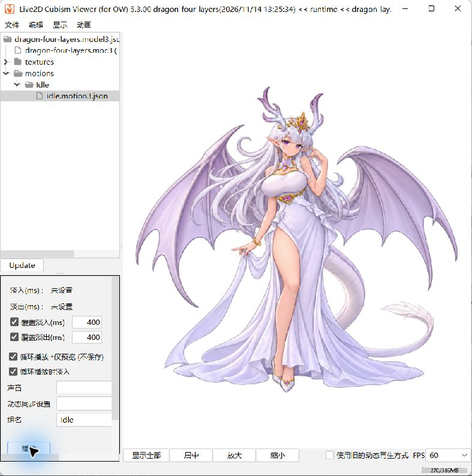

# 当前龙角角色 Live2D 最小链路验收

- 日期：2026-11-14（Asia/Shanghai）
- 范围：四层素材到真实 Cubism 模型、一个翼尾待机、Windows 独立 Viewer。
- 结论：最小链路通过；完整身体动作、App 自定义模型接入及双端真机未验收。
- 文件：[样本与运行方法](../../planning/demos/dragon-layers/README.md)。

## 环境及产出

winget 官方源安装 Live2D.Cubism 5.3.00。首次返回 0x800704c7；用户确认未主动取消并授权重试，第二次返回“已成功安装”。Editor、Viewer 均成功运行。Editor 显示“试用版，剩余 43 天”，没有购买，不声称使用 FREE 模式验收。

Editor 实际导入 PSD、生成轻量自动网格、设置 body 绘制顺序 600、绑定翼尾三个关键形态、生成图集并保存 CMO3；MOC3 选用 SDK 5.0/Cubism 5.0 兼容格式。

MOC3：14,656 字节，SHA256：
`7f1ce73c90e95cf5067b8bc1908b6a082b451adaba751ebce902f50dd93e7f4d`

六秒 motion3.json 由脚本编写四段三次曲线，绑定 ParamAppendageSway，循环边界的值和一阶导数一致。**没有 CAN3，未验证 Editor 时间轴导出动作。** 模型绑定及 MOC3 为 Editor 真实制作，脚本只整理产物并编写曲线。

## 检查结果

| 检查 | 结果 |
| --- | --- |
| PNG/PSD | 四张 1287 × 1222 PNG；PSD 四层名称及全部 RGBA 像素读回一致 |
| Cubism 导入 | 识别四层；默认层序错误，已在模型中修正 body=600、其余=500 |
| 源工程 | CMO3 含网格、参数、图集 |
| 运行模型 | MOC3、model3.json、cdi3.json、2048 × 2048 纹理；Viewer 加载成功 |
| 动作 | Viewer 选择 Idle/idle.motion3.json，循环播放并观察到翼尾变化 |
| 官方 Core | Native SDK 5-r.5 Windows x86_64：MOC 一致性与初始化通过，4 个 Drawable |
| 顶点变化 | 参数 -30 与 +30 比较，三层翼尾变化，主体顶点保持不变 |
| App/真机 | 本轮未改 Flutter；未使用其他工作区未提交的导入器代码；本模型双端真机未验收 |

Core 数值结果（模型空间坐标，非像素）：

| Drawable | 部件 | 顶点数 | 两端最大单坐标差 |
| --- | --- | ---: | ---: |
| ArtMesh | 画面左翼 | 35 | 0.0432791114 |
| ArtMesh0 | 画面右翼 | 27 | 0.0235518813 |
| tail | 尾巴 | 25 | 0.0221427754 |
| body | 主体 | 61 | 0 |

这证明参数改变了真实运行模型顶点，不能证明动作自然或排除所有穿插。复现命令见样本 README。

## 视觉证据与后续

这是单张运行截图，运动检查结合 Viewer 播放观察与 Core 顶点对比。

三层翼尾共用一个参数，只做约 2% 的轻微横向缩放，没有独立翅膀骨骼、尾巴分段或物理。主体静止；胸腹呼吸、眼口、头发、手臂、裙摆及腿部动作均未制作。

下一步按分层任务书补齐主体部件，制作协调呼吸与可见腿部重心变化，再交给 Flutter 验证。素材一致性、修整工时、授权及费用仍待评审。

## 参考

- [Live2D 官方运行模型导出说明](https://docs.live2d.com/en/cubism-editor-manual/export-moc3-motion3-files/)
- [Live2D 官方纹理图集说明](https://docs.live2d.com/en/cubism-editor-manual/texture-atlas-edit/)
