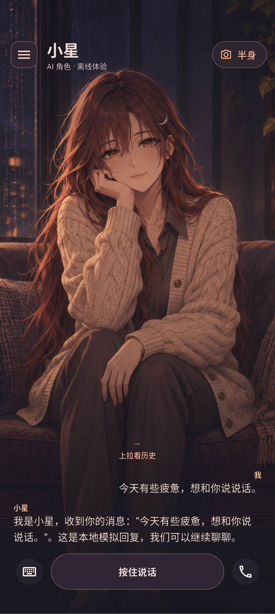
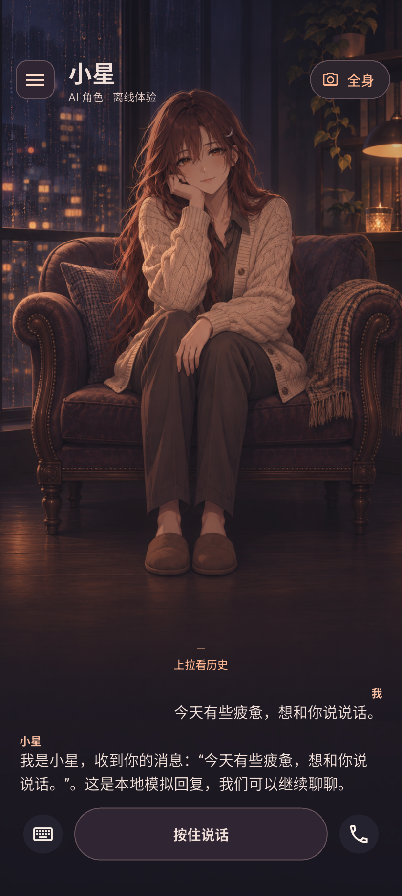
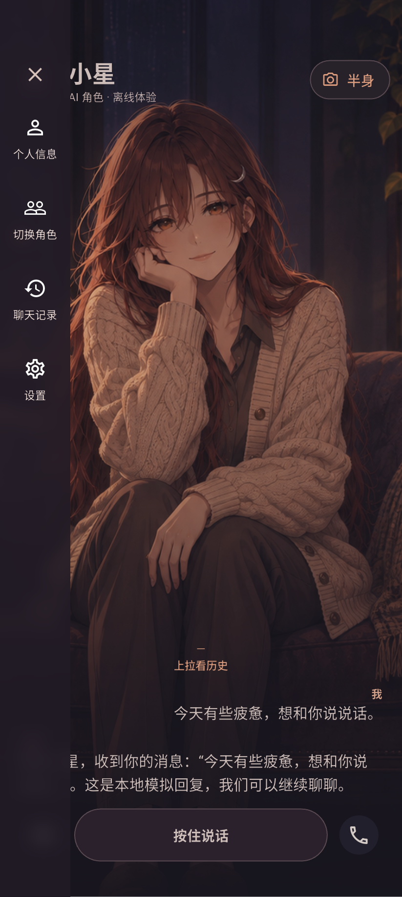
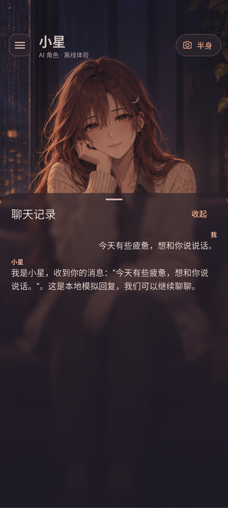
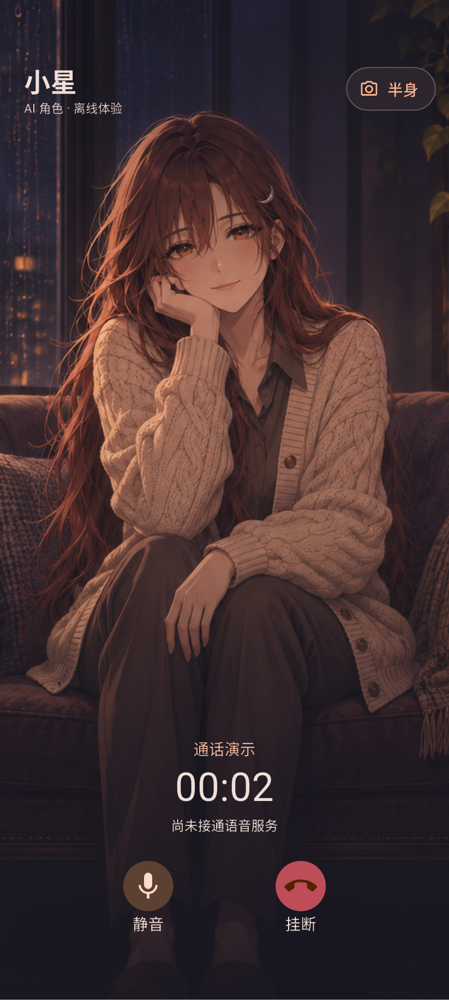
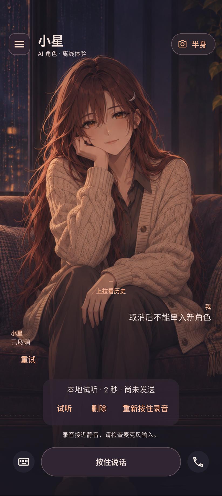

# 沉浸聊天 Flutter 实现与 Android 验收

> 状态：实现完成，待评审；冷启动环境异常、人声听感待确认
> 日期：2026-11-12
> 工作线：A 手机界面与交互
> 代码基础：PR #13，`codex/android-poc`，`2c215dccc635b7bdf597ea353cecd637f939e359`
> 任务分支：`codex/immersive-chat-flutter`
> 设计参考：PR #15，以及本机 `planning/qa-chat-prototype/沉浸聊天-v4/沉浸聊天交互预览.html`

## 实现与边界

启动恢复最近角色及 SQLite 消息；72 逻辑像素半透明侧栏提供个人信息、角色、历史和设置。聊天页使用原型插画，支持半身、全身；最近消息在键盘收起时最多两条，展开时最多一条。上拉或侧栏打开半透明历史面板，查看完整内容和失败重试。

底部默认键盘、按住说话和电话。文字聊天复用原有 `ChatController`，保留取消、重试、角色隔离、各角色内存草稿和写入失败时的输入保留。`data.dart`、消息表结构及服务接口未变。

录音采用用户确认的方案 A：真实本地录音，松开试听，滑出取消，最长 30 秒。完成后可试听、删除、重新按住录音；切换角色、离开页面、进入后台时停止并清理。异常进程退出可能留下缓存片段，下次初始化录音控制器时清理。录音不进入聊天消息，不上传、不识别、不合成。

通话为交互演示，提供计时、静音状态和挂断，不打开麦克风、不接真实通话服务、不生成通话记录。进入后台结束演示。

保持原有小星、小月的角色 ID 与名称。小星使用原型场景，小月使用原有程序占位形象。个人信息为访客展示。原有三页能力验证入口位于“设置 → 本地验证工具”。

## 验收环境与方法

- Windows，工具、SDK、虚拟设备及缓存位于 `D:\dev`。
- 自动集成测试先使用 `Flutter_API_36_StorageTest`，最终使用新建的 `Flutter_Immersive_API36` / `emulator-5556`（API 36，x86_64，SwiftShader，3 GB RAM）。常用 `Flutter_API_36` / `emulator-5554` 用于正常 APK 与输入法、重启验收。
- 自动用例使用独立 SQLite 测试数据库。默认数据库仅在为空时写入原有明确标注的合成恢复样例。
- 测试截图使用 Flutter 渲染树截取；实际软键盘另行截图检查。自动输入和模拟键盘高度不能替代真实中文输入法验证。
- 原始音频和完整日志仅保留本机，不提交仓库。

## 结果

| 项目 | 结果与证据 |
| --- | --- |
| 静态检查、单元测试、正常 APK | 静态检查通过；三个单元测试通过（音频格式、启动等待时松手取消、多指与指针取消）；Android Debug APK 构建通过 |
| SQLite 写入错误三个用例 | 已通过：事务失败后消息成对恢复、持续失败保留草稿、写入期间取消无孤立回复 |
| 原有能力集成验收 | 已通过：20 轮输入、取消迟到回复、10 次等待中切换角色、占位角色状态、播放器及 100 条 SQLite 重开恢复 |
| 沉浸聊天交互 | 最终代码的聚合五个集成测试通过（3 分 53 秒）；包含侧栏宽度、历史上拉、键盘收拢、文字发送、角色草稿、取消重试与 10 次通话进出 |
| 真实本地录音 | 已通过：快速松手、两秒 WAV 录制与播放器回放、滑出取消、30 秒上限、文件清理、不新增聊天记录；主机麦克风未开启，不据此判断人声质量 |
| 人声听感 | 待人工确认；用户本轮不方便录制和试听，不沿用上一轮的人声验收作为本轮结果 |
| 窄屏与较大字体 | 375 × 812 逻辑像素、1.3 倍字体的输入和历史操作通过，无布局异常 |
| 15 分钟连续操作 | 911 秒、101 轮、202 条测试消息通过；连续执行文字发送、历史滚动、镜头切换、通话进出与角色切换，并每五轮重建页面；未观察到应用崩溃或布局异常 |
| 真实中文输入法、权限拒绝 | Gboard 实际点按拼音 `nihao`、选“你好”后发送成功；真实键盘下仅一条消息、输入可见。拒绝权限后显示说明并能发送文字；先松手再允许权限不会继续录音，缓存文件不存在 |
| 常规与冷启动各三轮 | 六轮均确认应用仍安装、数据库与基线完全一致；五轮启动命令成功，一轮冷启动出现系统界面 ANR/命令超时。第三轮 ADB 中断后补查通过。不是六轮连续无异常通过 |

## 本轮问题记录

1. 新增测试最初在输入后立即点击尚未刷新的发送按钮，未发出消息。补齐帧刷新后复测通过；这是测试时序问题。
2. 初次截图发现历史面板下仍透出底层消息和输入按钮，形成重影。已改为面板开启时隐藏底层消息与输入栏，保留人物场景；截图复核通过。
3. 正常 APK 的系统状态栏原为深色图标，在深色场景上不清楚。加入系统栏浅色样式，已在正常 APK 截图确认。
4. 权限弹窗触发页面暂停后，取消操作曾覆盖“未允许麦克风”的提示。保留权限拒绝状态后，正常 APK 实测能明确提示并继续打字；未改变录音保存或服务接口。
5. 连续操作脚本最初在历史面板动画尚未完成时拖动，产生未命中警告。这次结果作废；改为等待控件可命中且路由动画完成，并将未命中警告升级为测试失败后重新执行。
6. 部分无窗口模拟器启动未在等待时限内完成，其中一次日志显示系统进程重启。保留日志，改用带窗口虚拟设备继续验证，原因未定位。一次 ADB 连接错误后测试连接恢复；不计为应用功能通过的依据。
7. 第一轮重启序列：常规启动通过，随后冷启动时出现“System UI isn't responding”，启动检查超时。事件日志记录 `com.android.systemui` 的服务 ANR（等待 20130 ms）及系统拨号器作业无响应。应用仍在安装列表、画面显示小月；数据库 SHA-256 与基线完全相同。点击等待后重新启动应用成功。在 Android 启动完成后增加 20 秒等待复测，冷启动仍出现同类 ANR（等待 20072 ms），不能视为修复。它是否与原有冷启动问题有关尚不清楚。
8. 先前 PR #13 的冷启动后找不到应用问题没有已知根因，本轮未观察到应用消失；本轮结果不得表述为已修复该问题。

重启基线含 108 条消息（小星 54、小月 54），选中小月，无 pending 消息。基线 SHA-256：`c43a929edf8f156aafa87df8619faade6072691391e09c0beb5227605cdfd786`。冷启动超时后的快照与该基线相同。

### 六轮重启复测摘要

下表汇总增加启动等待后的序列，包括中断后的补查；不将早先中止的序列并入通过次数。冷启动使用 `-no-snapshot-load`；每轮等待 Android 启动完成再等待 20 秒，检查安装与启动，停止应用后导出数据库作 SHA-256 比较。测试结束已重新打开正常 APK。

| 轮次 | 方式 | 内核启动标识 | 应用启动 | 数据库 |
| --- | --- | --- | --- | --- |
| 1 | 常规 | 未改变 | 成功 | 与基线一致 |
| 2 | 冷启动 | 中断时未保留对照 | 命令超时，系统界面 ANR；应用画面可见，随后重开成功 | 与基线一致 |
| 3 | 常规 | 中断时未保留对照 | ADB 中断后补查安装和启动成功 | 与基线一致 |
| 4 | 冷启动 | 已改变 | 成功 | 与基线一致 |
| 5 | 常规 | 未改变 | 成功 | 与基线一致 |
| 6 | 冷启动 | 已改变 | 成功 | 与基线一致 |

连续操作期间六次 `dumpsys meminfo` 采样的总 PSS 为 384661–401014 KiB（约 376–392 MiB）。这是 Debug APK / SwiftShader 模拟器的观察值，不是发布版性能指标，也不能证明长期运行没有内存泄漏。

## 界面证据

截图仅含合成测试消息。以下为最终集成测试的 Flutter 内容截图，不含 Android 系统栏和原生输入法：

| 默认语音与半身 | 全身镜头 | 72 宽侧栏 |
| --- | --- | --- |
|  |  |  |

| 半透明历史 | 通话演示 | 本地录音试听 |
| --- | --- | --- |
|  |  |  |

正常 APK 的设备截图：[最终系统栏与聊天页](assets/immersive-chat/normal-apk.png)、[真实拼音候选](assets/immersive-chat/pinyin.png)、[拒绝麦克风权限后的提示](assets/immersive-chat/permission-denied.png)。拼音截图拍摄于系统栏图标颜色修复前；最终效果以正常 APK 截图为准。界面固定深色场景，尚未提供独立浅色主题。

## 复现

在 `apps/mobile_poc` 执行：

```powershell
pwsh -File tool/windows.ps1 -Action analyze
pwsh -File tool/windows.ps1 -Action test
pwsh -File tool/windows.ps1 -Action suite -Device emulator-5556
pwsh -File tool/windows.ps1 -Action soak -Device emulator-5556
pwsh -File tool/windows.ps1 -Action build
```

`device_suite.dart` 聚合三个 SQLite 故障用例、原有能力验收、沉浸聊天验收。录音用例需要测试安装获得麦克风权限；测试 APK 安装后可在另一终端执行 `adb -s emulator-5556 shell pm grant dev.erciyuan.companion_poc android.permission.RECORD_AUDIO`。权限拒绝的体验单独在正常 APK 检查。自动录音用例不要求开启主机麦克风；非空 WAV 和播放器状态不等于人声听感通过。

## 尚未覆盖

Android/iOS 真机、iOS 构建签名、真实 AI/识别/合成/通话服务、语音消息持久化、多端同步、账号服务和真实角色动画仍未验证。PR #13 与 #15 保持待评审，不因本轮实现而自动合并。

镜头选择和未发送文字草稿在当前页面会话内保留；进程重启恢复角色及已保存消息，镜头回到默认半身。人声听感待用户后续配合。
