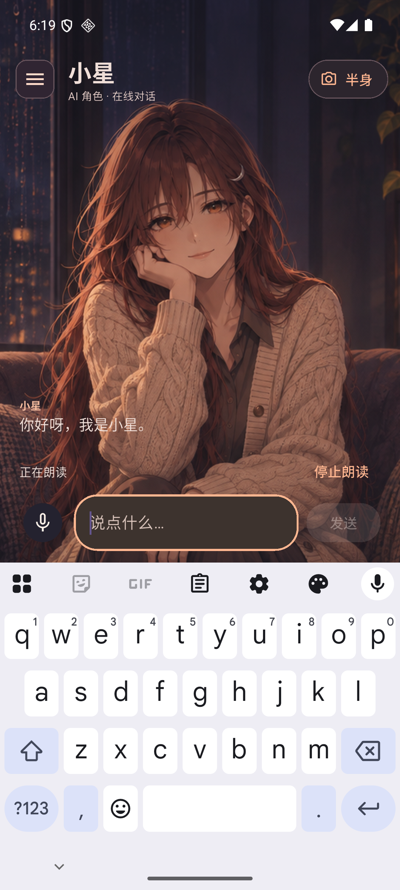
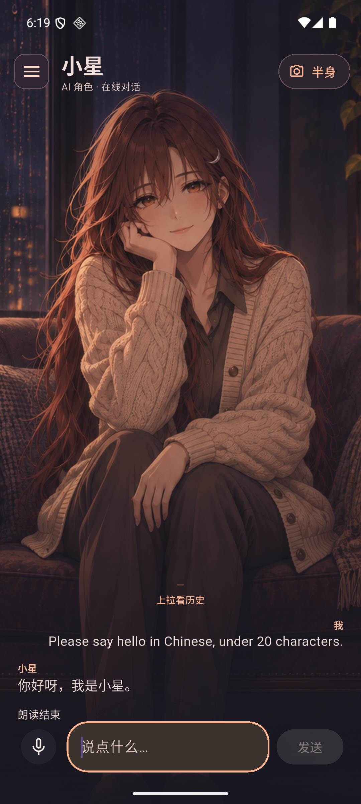

# DeepSeek 回复与 CosyVoice Flash 朗读验收

> 状态：实现完成，待评审；人工听感及 iOS 待验证
> 日期：2026-11-15
> 分支：`codex/deepseek-cosyvoice-gateway`
> 基础：PR #16 / `614ccad`；不合并原有 PR

## 实现

新增本机 Python/FastAPI 后端，DeepSeek 流式返回正式回复，完整回复保存到手机 SQLite 后才请求 CosyVoice Flash。完整 WAV 返回后调用原 Android 播放器；提供停止朗读和声音单独重试。角色切换、录音、后台等操作使旧声音请求失效。供应商密钥留在后端，手机仅持本机开发令牌。

录音转文字只预留 `501 ASR_NOT_IMPLEMENTED` 入口；原按住录音仍为本机试听，不上传。电话仍为演示。模型思考内容不显示、不保存、不朗读。聊天上下文取当前角色近期完成消息，不含失败/取消片段；数据库表结构保持不变。

## 已执行结果

| 检查 | 结果 |
| --- | --- |
| 后端单元与协议检查 | 9 项通过：请求去重/冲突、同角色完成回复约束、声音失败独立重试、鉴权/校验/ASR 占位、模型失败、取消、服务重启、DeepSeek 思考过滤与截断、CosyVoice PCM 协议 |
| Flutter 原单元测试 | 3 项通过，覆盖 WAV 静音判定及按住录音指针行为 |
| 后端真实模型短句 | DeepSeek 完成 13 字回复，文字首段约 0.59 秒、完成约 0.75 秒；随后 Flash 返回 164204 字节 WAV，合成约 2.5 秒 |
| Android 真实模型链路 | live 模式：真实 HTTP 调用、DeepSeek 回复完成、Flash WAV 返回、原生播放器进入播放状态；停止朗读后 SQLite 重开恢复两条消息通过。声音失败重试及切角色后的迟到音频注入通过 |
| Android 接口回归 | 最终 live 配置下三项通过（15 秒）：真实 HTTP/声音播放、角色上下文/取消/失败/重试不重复提问、声音失败独立重试及迟到音频丢弃。故障用例使用受控替身；另一次 mock 配置三项通过（11 秒），其静音 WAV 只验证传输与播放器 |
| Android 原有能力回归 | 修复后五项全部通过（2 分 7 秒）：三个 SQLite 写入失败用例、原能力集成验收、沉浸交互/本地录音验收；原测试未放宽 |
| 静态检查与正常 APK | 最终 flutter analyze 无问题；正常 Android Debug APK 构建、安装、启动通过 |
| 正常 APK 操作与进程重启 | 手动路径发送固定测试句，收到真实中文回复，显示正在朗读/朗读结束；切到小月后停止进程再启动，界面恢复小月，小星的 2 条消息保留，数据库 SHA-256 完全相同 |

真实短句使用合成测试指令，没有上传原有私人记录或录音。后端样本为 24 kHz 单声道、3.42 秒，RMS 约 0.087，包含非静音样本。计时仅为本机单次样本，不代表稳定延迟、手机端到端延迟或服务等级。原始音频和模型结果仅保留忽略目录 `.model-local/`。

正常 APK 的角色偏好/进程重启前后数据库 SHA-256：`2abdf0ed82591e9c88349310bf9360c6857302df7139fc5726a0ae4af7b4cc75`。最初只检查默认小星，默认角色不能证明偏好保存，故补做显式切换小月的重启检查。这是应用进程重启，不是六轮模拟器冷启动重测；先前系统界面无响应的原因仍未定位。本轮没有重新执行 15 分钟持续操作，不沿用旧版本结果冒充本版本结果。

## 正常安装包截图

使用专用 `Flutter_Immersive_API36` / `emulator-5556`、Android API 36；保留原常用 AVD 数据。截图只含固定测试提示及其模型回复。键盘展开时仍能看到朗读状态和停止按钮。

| 正在朗读，实际软键盘展开 | 完成回复与朗读 |
| --- | --- |
|  |  |

## 问题与边界

- 从带有 PowerShell 7 模块路径的工具环境启动 Windows PowerShell 5 时，服务脚本最初无法加载安全模块。改用 `pwsh` 启动后已能读取加密配置，未改变系统环境变量。
- 代码分析发现三处缺少大括号的风格提示，已补齐，最终静态检查无问题。
- 上下文检查发现取消或失败轮次的用户消息仍为 complete，单按消息状态过滤会把未完成提问带入后续上下文。已改为只纳入已有完成回复的用户消息，并补取消后切角色、重试上下文测试。
- 原有持续写入失败用例首次回归失败：新发送流程等待原生播放器停止，导致聊天提交与 busy 锁延后，检查时尚未进入保存。改为立即使旧音频失效、异步停止播放，同时让聊天同步占用发送锁；原草稿用例保持不变，修复后五项回归全部通过。
- 人工听感仍待确认，播放器状态与有效 WAV 不等于自然度、音量或听清内容已通过。
- 当前是本机单用户开发接口：有开发令牌、请求去重和并发上限，没有生产账号、多租户隔离、跨端同步、长期服务端记忆或部署验收。
- 当前开发音色可由两个角色共用；声音质量选型仍以 D 工作线盲听为准，不将自动合成成功当作音色定案。
- iOS 构建、签名、网络策略和真机声音链路未验证。

复现方式见 [运行指南](../guides/model-gateway-20261115.md)，协议边界见 [v0 契约](../接口/model-gateway-v0.md)。
