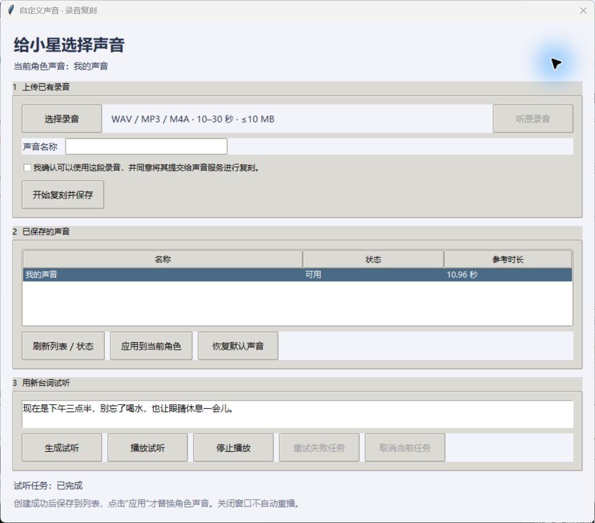
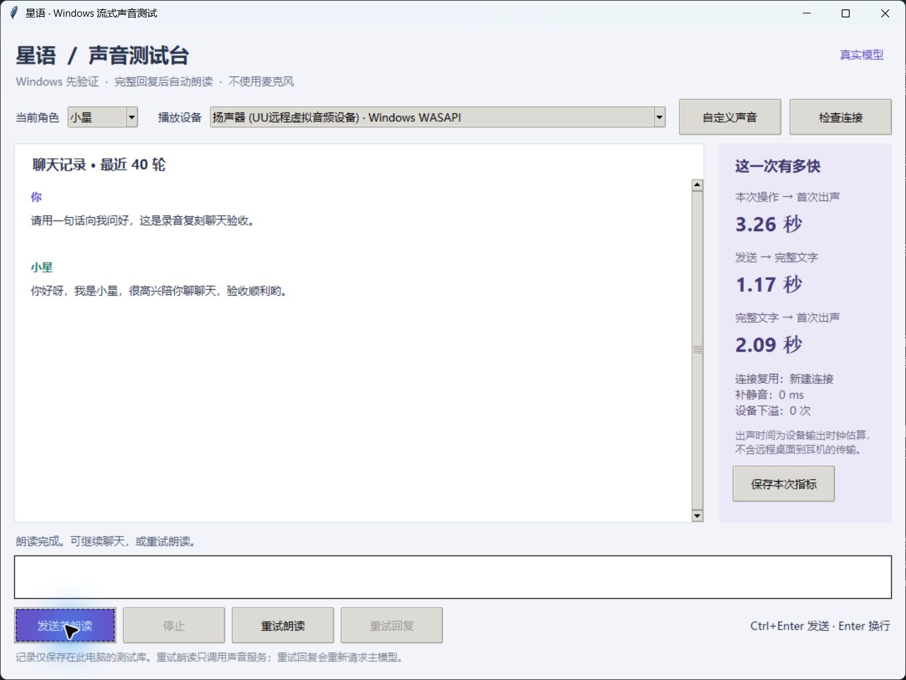

# Windows 录音复刻验收

> 状态：评审中；自动与真实调用验证通过，人工听感待确认
> 日期：2026-11-16
> 负责人：待定
> 关联：D 声音、codex/recording-voice-cloning；PR 均不合并

## 本轮结果

Windows 已跑通录音选择/上传、CosyVoice Flash 创建音色、新台词试听、保存列表、应用到角色、恢复默认、重新应用和关闭重开恢复。仅使用已有 Qwen Serena 合成参考 WAV（24 kHz 单声道，10.96 秒），没有上传私人录音或实现文字描述功能。

GUI 上传后列表显示“我的声音 / 可用 / 10.96 秒”。这个名称是测试时界面默认值，指合成参考复刻结果，不是用户本人的录音。生成试听成功并完成设备播放，应用到小星成功；小月绑定未变化。

独立任务分支基于原 Windows 工作目录先保存的 `4cb169f` 检查点，该检查点包含 Windows 聊天测试台；前置服务代码继承 PR #22 的 `48e8a0b`。没有合并 PR #13/#15/#16/#21/#22/#23；当前分支与上述 PR 存在继承关系，评审时需区分既有基础和本轮音色增量。

## 真实调用与设备指标

环境：Windows、Python 3.12、FastAPI 本机回环网关、既有进程代理；DeepSeek 完整回复 → CosyVoice v3.5 Flash → 24 kHz PCM16 单声道；Windows WASAPI 输出设备。没有更改系统音频、隐私或代理设置。

| 验收项 | 实测 | 结果与边界 |
| --- | --- | --- |
| GUI 上传与创建 | 云端返回音色，可查询为可用 | 真实调用通过；非替身 |
| 原音频 | 10.96 秒；设备下溢 0、补静音 0 ms | 原文件 hash 不变 |
| 三句新台词试听 | 生成并查询完成约 2.05–2.07 秒；成品 2.54 / 3.50 / 4.78 秒 | 完整文件试听；这个耗时含 1 秒轮询间隔，不代表首包延迟 |
| 三句试听播放 | 全部播放完成；下溢 0、补静音 0 ms | 听感未确认 |
| 相同文件再上传 | 仍只有 1 个可用音色 | 重用原任务，未重复创建 |
| 角色隔离 | 绑定小星；小月保持不变 | 真实接口验证 |
| 热连接聊天 | 20/20 成功、20/20 复用连接 | 另有第 0 条不计入统计；它已被试听预热，不能称为冷连接 |
| 完整文字 → 设备首次出声 | P50 **0.939 秒**，P95 **0.954 秒**，最大 **0.966 秒** | 达到本批 1.5 / 2.5 秒目标；仅限固定短句和本机环境 |
| 发送 → 设备首次出声 | P50 **1.772 秒**，P95 **1.875 秒** | 含 DeepSeek；不能推广到所有开放式长回复 |
| 连续播放 | 21 条短句下溢总计 0、补静音总计 0 ms | 某条末尾对齐补零 10 ms 属于正常尾部填充，不是中途断流 |
| 真实朗读停止 | 已检测设备开始输出；停止调用完成约 **6 ms** | 非声学停止测量；完整文字保留 |
| 单独重试朗读 | 成功；操作到设备出声约 **1.198 秒** | 停止后新连接；不重新调用 DeepSeek；下溢/补静音均为 0 |
| GUI 实际聊天（另测） | 闲置后新建连接；文字完成到设备出声 **2.09 秒**，发送到出声 **3.26 秒** | 较长问候语；没有混入 20 轮固定短句热连接统计；下溢/补静音均为 0 |
| 历史恢复 | 独立库 22 轮重开一致，integrity_check=ok | 日常聊天库未用于自动验收 |
| 音色恢复 | 重启网关、重开窗口，音色与绑定仍在 | 关闭/重开没有自动重播 |
| 文件清理 | 成功音色无临时参考残留 | 原文件未改写，试听 WAV 留本机临时目录 |

热连接固定提示为“请只回复‘你好，我在这里。’”，测得音频约 2.14 秒。停止测试使用新的公园介绍回复，再用同一完整文字重试朗读。PortAudio `outputBufferDacTime` 估算首次幅度超过阈值的样本输出时间；未通过麦克风测声学延迟，不含远程桌面到耳机传输。

原始指标位于本机忽略目录 `.model-local/recording-clone-acceptance/live/result.json`，不含供应商密钥；原音频、测试数据库及云端音色 ID 不上传 Git。可复现命令见[操作指南](../guides/recording-voice-cloning-20261116.md)。

已提交不含身份信息的[逐轮指标摘录](assets/recording-voice-metrics-20261116.json)。以下是本机实际窗口截图（浅色、当前 Windows 缩放；未验证其他主题或所有窄屏尺寸），仅显示合成参考与固定验收台词：

## 自动测试（供应商替身，非真实云端故障注入）

- 网关：**36 passed**，包含原有 20 项聊天/流式测试及本轮音色测试；已有 Starlette/AnyIO 弃用警告 1 条，不影响结果。
- Windows 原聊天客户端：**9 passed**，涵盖 SQLite 恢复、角色隔离、取消、声音重试、损坏音频和写入失败。
- 本轮覆盖：鉴权、文件/字段校验、重复 ID 冲突、同内容复用、坏文件/静音/短长/低采样率拒绝、MP3/M4A 真实解码、未知结果只读核实、失败重试、临时参考过期后重传、取消创建后的迟到结果、试听取消/重试、角色绑定版本与保存失败回滚、配置范围隔离、重启恢复、旧 speech_id PCM 缓存不换声。
- MP3/M4A 验证为本机 FFmpeg 转码与解码 + 替身创建；本批真实云端上传仅验证 WAV。人工音色相似度不由这些测试证明。

## 问题与处理

| 问题 | 排查与处理 | 当前状态 |
| --- | --- | --- |
| 面板底部状态/按钮被挤压 | 状态区固定在底部，减少列表初始行高，调整尺寸与位置 | 重开目测按钮和提示完整 |
| 独立测试库启动失败 | PowerShell 数组拼接导致 `--data` 值两侧多空格；修正参数格式 | 相同路径重启通过 |
| MP3 测试样例被判近静音 | 初始测试信号为 Nyquist 交替方波，被 MP3 低通滤掉；改用 500 Hz 样例 | 解码校验通过，保留静音拒绝规则 |
| 保存失败可能显示通用网络错误 | 为音色持久化失败增加明确错误码，绑定事务回滚 | 故障注入通过，旧选择保留 |
| 同时重试试听可能重复排队 | 新试听和重试共用忙碌检查 | 自动测试覆盖；仍是单用户服务 |
| 重开面板时默认台词与已有试听不一致 | 返回并恢复该次试听台词 | 重开恢复验证；编辑后需重新生成 |

## 尚未验收或不包含

- **人工听感待确认**：音色相似度、自然度、电音、断词和音量；不能把零缓冲断流写成“无电音已确认”。此前其他版本的听感反馈不代替本轮。
- 未使用真实用户录音；未测试嘈杂、多说话人或录音质量极差场景的复刻效果。
- Android/iOS 自定义声音 UI、真机、多人账号隔离、云端音色删除、超额资源归档尚未实现。
- 取消创建无法撤销云端已提交请求；未知创建结果不能确定时保留待核实，不自动再花一次创建额度。
- Windows 默认聊天库及 Flutter 数据模型保留；本轮未重新跑 Android/iOS 测试。
- 本次 20 轮是预热后的固定短句测试，不是冷启动或大规模长稳测试；没有证明所有网络与台词均在 1 秒内出声。

功能代码和接口可供评审，PR 保持草稿、不合并；人工听感及移动端接入另行补验收。
