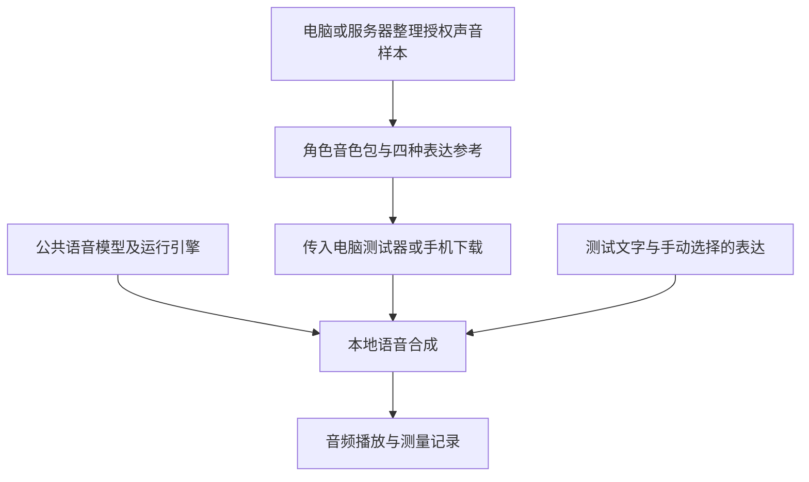

# D 工作线：单角色端侧语音方案与验证计划

> 状态：评审中
> 日期：2026-11-13
> 负责人：待团队分配
> 关联：D 声音处理，A/B 后续接入，ADR-0001、ADR-0002、任务 #10
> 执行状态：仅形成方案；模型下载、环境安装、样本处理、合成与手机试验均未开始，等待项目发起人确认。

## 1. 本轮要回答的问题

能否为一个角色准备平静、开心、安慰、疑惑四种表达资料，让本地语音模型对未见过的新文字生成可懂、自然且音色一致的声音，并最终在目标手机上运行？

拟采用“服务器或电脑制作音色包，手机加载公共语音模型与角色资料”的结构。每次说话仍需本地推理，但不按句调用云端 TTS。普通录音和云服务的音色编号都不能独立完成文字转语音。

本轮先验证电脑，再验证独立手机样例。四种表达的选择由测试人员手动指定；对话大模型自动选择情绪、现有聊天 App 集成、语音识别、实时通话、多角色和精确口型均留待后续。本轮通过不代表 D 工作线全部完成，也不关闭 [#10](https://github.com/wangyz0518-bit/erciyuan_AI/issues/10)。

本文为技术方案及试验设计，不是最终模型选型或接口契约。阈值均为建议验收目标，不是已有测量结果或厂商承诺。

## 2. 拟采用的结构和候选路线

公共模型由角色共用；角色包可包含音频与逐字稿、预提取特征、表达映射和兼容版本信息。具体内容取决于模型，不预先承诺每个角色都能压缩成一个很小的向量。仅当所用引擎支持特征复用时，才缓存提取结果；否则先使用短参考音频。音色包必须与对应模型版本配套。

| 候选 | 本轮用途 | 已查到的能力与限制 | 进入下一步的条件 |
| --- | --- | --- | --- |
| ZipVoice-Distill + sherpa-onnx | 首选电脑 CPU / 端侧路径候选 | 官方提供中英文离线克隆、INT8 模型和 Dart/Swift 示例；需参考音频及匹配文本，还需声码器。尚无本项目四种表达的实测证据 | 先证明音色、四种表达和中文可懂度，再评估手机速度 |
| Qwen3-TTS Base | 电脑上声音克隆的对照候选，优先评估较小版本 | 支持复用克隆提示；不能把 Base 的克隆能力等同于 CustomVoice 的自由风格指令能力 | 克隆及参考风格效果合格，且存在可接受的移动部署路径时，才进入手机候选 |
| 角色专用微调或更换模型 | 首轮失败后的备选 | 会增加数据、训练、分发和维护工作；本次不默认执行 | 先提交失败证据、额外样本要求与资源预算，再确认新方案 |

依据：[ZipVoice 部署说明](https://k2-fsa.github.io/sherpa/onnx/tts/zipvoice.html)、[ZipVoice 官方项目](https://github.com/k2-fsa/ZipVoice)、[Qwen3-TTS 官方项目](https://github.com/QwenLM/Qwen3-TTS)。资料核对日期：2026-11-13；正式试验须冻结具体版本、权重来源与校验值。

sherpa-onnx 有 Android、iOS 和 Flutter 支持，但框架支持不证明任一模型已经在我们的目标设备上达到实时速度。平台依据见 [sherpa-onnx 官方项目](https://github.com/k2-fsa/sherpa-onnx)。

### 四种表达如何实现

先从同一人、同一角色的四组参考录音选择风格条件，测试模型是否能把表达迁移到新台词。仅在模型明确支持时使用风格指令或其他控制参数。语速、音高调整只作辅助，不把改变播放速度算作情绪能力。

先固定为四种表达、单一适中强度；按完整短句合成，避免句中频繁切换参考。情绪参考之间可能发生音色漂移或无法区分，必须按第 5 节判定。若只有平静合格，只能记录为“基础克隆部分通过”，不能宣布四种表达通过。

## 3. 需要准备的声音样本

### 录音清单

建议同一位有授权的说话人演绎一个固定角色，不混入不同人的素材。开始前由发起人选择角色声音方向，例如自然青年女声或温和青年男声，并指定最终试听确认人。

| 样本 | 数量与单段时长 | 内容与表演要求 |
| --- | --- | --- |
| 平静 | 3 段，每段 10～15 秒 | 自然聊天，不使用播音腔 |
| 开心 | 3 段，每段 10～15 秒 | 轻快、有笑意，避免尖叫和夸张变声 |
| 安慰 | 3 段，每段 10～15 秒 | 柔和、耐心、有适当停顿；不要只放慢速度，也不要求耳语 |
| 疑惑 | 3 段，每段 10～15 秒 | 温和询问和不确定感，避免演成生气或质问 |

共 12 段，约 2～3 分钟。每种表达至少两段使用不同内容，一段可使用四种表达共用的文字，便于检查是否仍像同一个人。建议录两遍，由准备阶段选较自然的一遍；所列数量指最终保留样本。

建议原始格式：WAV、PCM 16-bit、单声道，44.1 或 48 kHz。手机原始录音也可先提供，保留原件后按模型要求转换；不能靠升采样把低质量录音变成高质量录音。统一设备、位置和音量，安静室内录制，无背景音乐、混响、削波和其他人声，不做强降噪、变速、变调或美化。

每段须有准确逐字稿，包括实际说出的语气词。使用中性文件编号，如 `voice01_calm_01.wav`，记录表达标签和时长，授权信息单独保存，不把姓名写进公开测试记录。

### 可参考的录音台词

以下仅作录音提示，可增加连贯内容达到建议时长，不必刻意拖长。所有录音台词都不能再用作正式验收的新句子。

| 表达 | 台词示例 |
| --- | --- |
| 平静 | 今天下午我整理了一下房间，窗边刚好有阳光。等你忙完，我们可以慢慢聊聊今天发生的事情。 |
| 开心 | 我刚刚发现了一件特别有趣的事情，一直想等你回来再告诉你。现在终于能和你一起分享啦。 |
| 安慰 | 今天已经做了很多事情了，先让自己休息一下吧。不用急着把所有问题解决，我们可以一件一件来。 |
| 疑惑 | 我想再确认一下，你说的是昨天那件事情，还是今天刚发生的？我可能漏听了一点，你愿意再讲讲吗？ |
| 四种表达共用 | 原来你也在这里，我刚才还在想今天会不会遇见你。 |

### 原始样本与推理参考要分开

上述 10～15 秒是采集素材长度，不要求把整段送入每次推理。准备阶段从中截取连续、自然、无明显噪声的短片段，保存对应逐字稿；按各模型建议分别比较参考长度。ZipVoice 官方建议单说话人使用较短提示（例如少于 3 秒）以改善速度；不能把其他云 API 的样本长度直接套用到它。[参考长度与优化说明](https://github.com/k2-fsa/ZipVoice)

首轮不做训练，不需要先收集数小时录音。若缺少某种表达样本，将该项标为“未准备”；不默认用其他人的声音或云端生成音频替代。

## 4. 确认后的实施步骤

| 步骤 | 具体工作 | 交付与继续条件 |
| --- | --- | --- |
| 0. 确认范围和输入 | 确认本文、角色方向、样本来源、试听人员、电脑配置和目标手机 | 记录执行确认；此前不开始安装或试验 |
| 1. 样本整理与环境准备 | 检查录音和逐字稿；冻结模型、运行库、许可与权重版本；在项目下隔离环境和本地素材 | 样本检查表、可复现环境记录；不上传私人样本或调用付费服务 |
| 2. 电脑基础克隆 | 先用平静参考读新句子，测中文可懂度、音色和 CPU 推理；必要时测 GPU 作为独立对照 | 平静输出可用；记录是否实际依赖 GPU |
| 3. 四种表达筛选 | 用 8 条开发句分别生成四种表达，共 32 条；比较不同参考片段及支持的控制方式 | 选定候选配置；不能区分表达则记录失败，不直接进入手机 |
| 4. 电脑正式验收 | 冻结配置后使用未参与调参的测试集；执行盲听、延迟、稳定性及离线检查 | 形成第 5 节结果；质量合格且性能有移动部署希望才进入下一步 |
| 5. 独立手机样例 | 先 Android 真机，再 iOS 真机；使用同一模型与角色资料，完成加载、输入、选表达、合成、播放、停止 | 逐设备测量；模型转换或量化后重新验音质，不拿电脑成绩代替 |
| 6. 团队评审 | 总结通过、失败、未测及设备限制，提出模型选择和接入建议 | 另行评审 App 接口和集成变更；本轮不修改聊天数据库 |

### 后续拟建的工程范围（本次不创建）

- `experiments/voice_poc/`：电脑独立测试入口、候选适配、试听和指标记录。
- `apps/voice_poc/`：电脑通过后再建的 Flutter 手机样例；不与正在开发的 `apps/mobile_poc` 混改。
- 项目下的本地忽略目录：原始声音、处理后参考、模型权重、生成音频与原始日志；创建前先补齐忽略规则。模型缓存、下载和生成产物放 D 盘。
- `docs/reports/`：实际执行后新增验收报告与脱敏统计，区分电脑 CPU、电脑 GPU、Android 和 iOS。

这些目录是拟议组织方式，不构成公共接口、存储模型或最终架构决定。未来角色绑定由 B 管理，A 负责播放和操作，D 提供合成与能力说明；对话模型自动输出表达意图的接入在本轮之外。

## 5. 验收设计与建议标准

### 固定测试集

调参只使用第 4 节的 8 条开发句。正式测试集在正式验收前冻结，不能来自参考录音，也不能边验收边挑成功样例。

| 组别 | 内容 | 数量 |
| --- | --- | --- |
| 同文四表达 | 20 条内容较中性的短句，每条分别用四种表达合成；主要短句长度 10～40 汉字 | 80 条 |
| 场景句 | 四种表达各 3 条自然场景台词，观察表达是否与内容一致 | 12 条 |
| 边界句 | 两条长句（100～200 汉字）、两条 2～6 字短句，以及人名/多音字、数字日期、中英混读、标点停顿各一条；默认平静 | 8 条 |

合计 100 个“文字＋表达”组合，每个配置重复生成 3 次，共 300 次。固定或记录随机种子、生成参数和模型版本；保留全部成功与失败结果。重复运行中失败同样进入分母；不能通过自动重试隐藏失败率。

正式集若被用于改配置，则该轮降为开发试验，下一轮补充未见过的测试句重新验收。边界组用来发现极短句漏字、长句重复、多音字和数字等问题，不能用全局平均数掩盖严重错误。

### 试听与发音

| 项目 | 方法 | 建议通过目标 |
| --- | --- | --- |
| 自然度 | 至少 3 位中文试听者，包含发起人或指定确认人；每人对第一轮 100 条按 1～5 分评分（1 明显不可用、3 可懂但机械、5 自然） | 每种表达的平均分 ≥ 3.5；不是厂商标准 MOS |
| 音色一致性 | 先听角色参考，再对同批输出按 1～5 分评价是否同一人；与自然度分开打分 | 每种表达平均分 ≥ 4；不能靠改变成另一个声音提高情绪分 |
| 四种表达可辨识 | 对同文四表达的 80 条隐藏标签、随机排列，三人各独立选四类之一，不并排提示四条对应关系 | 总体正确率 ≥ 70%，每类 ≥ 60%；报告混淆矩阵和各人结果，不只报平均值 |
| 可懂度与完整性 | 人工核对全部 300 条输出；ASR 只能辅助。按统一转写规则统计替换、删除、插入错误 | 字错率 ≤ 2%；无整段漏读/重复、无改变否定或关键数字含义的错误 |

字错率采用 `(替换＋删除＋插入)/参考字数`，先统一数字读法、英文大小写和标点处理规则。严重错读单独列出，即使总体低于 2% 也不能算通过。80 条盲听必须按原始输出随机抽号，不挑最好的一次；若需要试听响度归一化，仅用于试听副本且记录处理，不改变原始测量音频。

三人盲听是小样本工程评估，不代表统计上证明所有用户都满意。人数不足时可以筛选候选，但正式质量结论仍记为待补。

### 性能、离线和异常处理

以下默认验收口径为实际播放路径；电脑记录 CPU 和 GPU 两套结果（如有），手机按型号单列，不能混合汇总。

| 项目 | 定义与方法 | 建议通过目标 |
| --- | --- | --- |
| 首声延迟 | 从点击合成/接受请求到第一段非静音内容进入播放输出，包含预处理、推理和播放缓冲；首包返回时间另外记录 | 模型已加载时，10～40 汉字组 P50 ≤ 1 秒、P95 ≤ 2 秒 |
| 持续生成速度 | RTF＝音频生成耗时/输出音频时长；记录边界长句和连续播放的实际停顿 | 热运行长句组 RTF P95 ≤ 0.8，播放过程中不因后续音频未生成而断续 |
| 冷启动 | 结束应用进程后重新启动，模型在本地；分别记录加载时间及首次发声，总计 5 轮 | 先完整报告 P50/最慢值；目标首次发声 ≤ 5 秒，不纳入热运行数字 |
| 离线新句子 | 下载完成后关闭网络，用未合成、未缓存的 10 条文字生成；记录网络关闭状态和新输出 | 10/10 成功；确由本地推理产生，不是录音回放或云端回退 |
| 稳定性 | 300 次正式合成；另连续运行相同负载至少 15 分钟 | 300/300 成功，无崩溃、卡死、空音频和明显内存持续增长 |
| 停止和取消 | 合成中与播放中分别停止，共 20 次；再次发起新任务 | 20/20 不播放迟到结果、不串入新任务；点击停止后输出音频目标在 300 ms 内停止；不能中断推理时须记录仍消耗计算 |
| 异常与回退 | 空文本、缺失/损坏音色包、不匹配版本、不支持的表达 | 明确报错或使用注明的平静回退；回退结果不算目标表达通过 |

若模型不支持流式输出，首声延迟必须包含完整句生成时间。首声计时可先用播放回调及首个非静音样本位置估计，并用系统回录或外部录制抽查；测量方法和误差要进入报告，不把“收到数据”当作“已经发声”。

### 手机资源预算与平台边界

初始资源目标：公共语音资源下载量 ≤ 500 MiB（含模型、声码器和必要词典），单角色包 ≤ 20 MiB，独立样例峰值进程内存 ≤ 1 GiB。分别报告压缩下载量、解压占用及运行内存；这些是团队评审预算，不是已知模型大小。超标时提出裁剪、量化或修改预算的依据，不静默降低标准。

手机先指定一台有代表性的 Android 真机，之后指定 iPhone，记录芯片、内存、系统和构建模式。使用 Release 或明确记录的性能构建，保持相同测试文本与配置。连续测试记录电量变化、可读温度/热状态和前后速度；最后 5 分钟的同类请求延迟相对最初 5 分钟恶化超过 20%，需分析降频原因。15 分钟只作初筛，不推算续航。

Android 模拟器只验证操作和集成，不用于速度、耗电或发热验收。没有 iPhone 或构建环境时，iOS 标为“未验证”；Android 通过不能代表双端通过。原生鸿蒙不在本轮范围，遵循 [ADR-0002](../decisions/0002-three-platform-scope.md)。

## 6. 结果判定与失败后的处理

- **电脑质量通过、性能可行**：进入独立手机样例；上机后重测量化/转换造成的质量变化。
- **能克隆但四种表达不合格**：先在开发集调整参考片段；仍失败则比较另一候选，或提交微调方案。不得用更快、更响的后处理冒充情绪通过。
- **电脑 GPU 合格、CPU/手机不合格**：记录为桌面能力，不宣布端侧可行。再评估压缩/蒸馏、不同端侧模型或有限设备范围。
- **手机基础语音合格、表达不合格**：本轮目标部分通过；是否接受平静版本必须另行决定。
- **需要云端兜底**：明确这会改变离线目标和费用边界，先审阅，不自动接入。

结论用“通过 / 部分通过 / 失败 / 未验证”逐项记录，保留失败音频编号、原因与复现条件。最终选择另写 ADR；本文不直接定案模型。

## 7. 数据、交付与待确认事项

模型和音频在项目下 D 盘本地目录管理；仅提交程序、配置模板、虚构测试台词和脱敏统计。原始声音、可识别个人的生成声音、音色特征、模型权重和授权资料不提交 Git。向伙伴提供试听材料时，由素材提供者确认分享范围，使用单独的受限渠道。

执行前核对模型权重、声码器及依赖的使用和分发许可；云端合成结果不能默认用于训练或重新分发。首轮以本地推理为边界，不默认上传录音、购买服务或租用 GPU。如硬件不足或需要付费，先给出具体用量和预算。

正式执行后的交付：可复现电脑测试器、角色包构成说明及本地样例、四表达试听结果、逐次性能记录、错误清单；进入手机阶段后补充独立安装包与分设备报告。生产 App 接口、正式数据模型及服务端上传链路另行评审。

开始实施前需要确认：

1. 是否接受“一个角色、四表达、先电脑后独立手机样例”的范围和候选顺序。
2. 谁提供授权样本，角色声音方向，以及最终试听确认人；至少三名盲听人员如何安排。
3. 第 5 节质量、延迟和资源阈值是否作为本轮试验目标。
4. 可用的 Android/iPhone 型号与 iOS 构建条件；尚未准备的设备明确记为待补。

本次仅提交本文和索引供审阅，不安装模型、不处理声音、不开始合成、不修改 App。文档提交或合并均不替代项目发起人对实施的明确确认。
