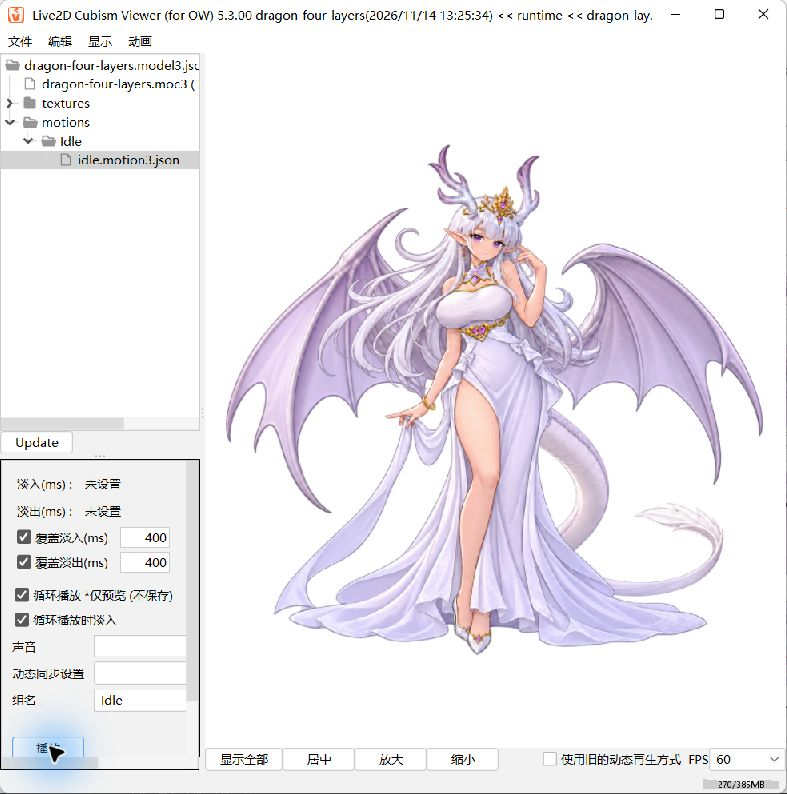

# 当前角色：AI 素材到 Live2D 的最小 Demo

日期：2026-11-14。**已跑通 AI 四层 PNG → PSD → Cubism 真实绑定 → MOC3 → 独立 Viewer 循环播放。**

当前仅有翼尾小幅联动，主体静止。这是制作链路样本；胸腹呼吸、眼口、挥手和腿部换重心仍需拆分素材并绑定。本模型的 Flutter、Android/iOS 真机接入尚未验证。

## 直接体验

1. 在 Windows 安装 Live2D Cubism Viewer（随 Editor 安装）。
2. 打开 `runtime/dragon-four-layers.model3.json`。
3. 展开 `motions → Idle`，选择 `idle.motion3.json`，勾选“循环播放（仅预览）”，点击“播放”。
4. 当前机器已打开 Viewer 并开始循环。一个周期 6 秒，动作幅度刻意保持很小。



## 交付内容

| 路径 | 用途 |
| --- | --- |
| assets/*.png | imagegen 生成的主体、画面左右翼、尾巴 |
| source/dragon-four-layers.cmo3 | Editor 保存的网格、参数及图集源工程 |
| runtime/dragon-four-layers.moc3 | Editor 真实导出的 SDK 5.0 兼容模型 |
| runtime/dragon-four-layers.model3.json | 模型、纹理、动作的入口 |
| runtime/dragon-four-layers.2048/texture_00.png | Editor 生成的 2048 × 2048 图集 |
| runtime/motions/idle.motion3.json | 手工编写的六秒循环曲线 |
| build.cjs | PNG 包装为 PSD，保留 RGBA 像素 |
| package-runtime.cjs | 整理 Editor 导出物并编写动作，不生成 MOC3 |
| verify-core.ps1 | 用本机官方 Cubism Core 校验模型及顶点变化 |

CMO3 是制作源文件，App 使用 runtime 目录。当前不是正式 avatar ZIP 包，不改变既有包 Schema。没有 CAN3；动画源为可审阅的 package-runtime.cjs，本次没有验证 Editor 时间轴导出流程。

## 素材检查与重建

在本目录运行（需要 Node.js、pnpm）：

```sh
pnpm install --frozen-lockfile
pnpm run build
node serve.cjs
```

访问 http://127.0.0.1:8766 ，可隐藏图层、切换背景、分开展示和重置。网页仍为静态素材检查器，Live2D 动作使用上方 Viewer。

输出 build/dragon-four-layers.psd 和 build/preflight.json，1287 × 1222、8 位 RGB、四个 RGBA 图层。四张 PNG 保留完整画布与原点 (0,0)，未校验色彩配置；需检查实际导入颜色。build/ 和 node_modules/ 不进 Git。

**实际导入注意：** 本次 Cubism 默认绘制顺序均为 500，翼尾盖住主体。已在 CMO3 中设置 body=600，其余=500。网页或 PSD 像素读回不能代替编辑器遮挡检查。

编辑源工程后，将同名 CMO3 和 MOC3 配套文件导出至本目录 build/，再运行：

```sh
node package-runtime.cjs
```

脚本更新 source/ 与 runtime/，保留修改前检查 Git 差异。

Windows 原生验证（自备官方 Native SDK，仓库不含 Core DLL）：

```powershell
./verify-core.ps1 -CoreDll '你的SDK路径/Core/dll/windows/x86_64/Live2DCubismCore.dll'
```

## 来源与限制

使用会话内置 imagegen，四次部件提取加两次边缘清理；不是 Seedance/Seedream 调用。参考为[既有角色立绘](https://github.com/wangyz0518-bit/erciyuan_AI/blob/46b8d6c/apps/mobile_poc/assets/characters/dragon-character-v1.png)，完整提示词见 [prompts.md](prompts.md)。

生成会改变局部脸、发丝及翼根，不是原图无损拆层。首版主体和左翼的大面积雾边经第二轮改善。当前三层翼尾共用 ParamAppendageSway（-30～30，0 为默认形态），只做约 2% 的横向缩放，没有独立关节或物理；参数值不是头部角度。

Editor 显示“试用版，剩余 43 天”；启动选择结果与预期 FREE 模式不一致，已告知用户，没有购买。本次不代表 FREE 模式限制已验证，也不推定素材商业权利已核清。

见[详细验收](../../../docs/reports/dragon-live2d-minimal-20261114.md)、[完整分层任务书](../../../docs/research/dragon-layer-materials-20261114.md)及[待执行决策](../../../docs/decisions/0003-avatar-live2d-video-demo.md)。
